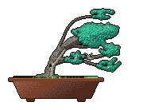

  
  <picture></picture>
  

  <a href="https://github.com/Failexius"><picture>
    <source media="(prefers-color-scheme: dark)" srcset="cards/stats-dark.svg">
    
  </picture></a>
  <a href="https://github.com/Failexius?tab=repositories"><picture>
    <source media="(prefers-color-scheme: dark)" srcset="cards/languages-dark.svg">
    
  </picture></a>

